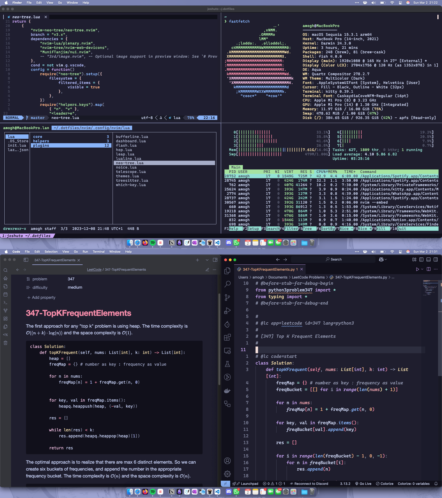

Managed with [GNU stow](https://www.gnu.org/software/stow/). Clone this repo to `~/.dotfiles` and run
`stow -t ~ <package>` per package to deploy — see [STOW.md](STOW.md) for the full command reference
and [SETUP.md](SETUP.md) for bootstrapping a new machine.

# My current MacOS setup



## Resources:  

- [fish shell](https://fishshell.com/) - Smart and user-friendly command-line shell  
- [Kitty](https://sw.kovidgoyal.net/kitty/) - Fast, feature-rich, and GPU-accelerated terminal emulator  
- [Neovim](https://neovim.io/) - Modernized and extensible Vim-based text editor for quick terminal edits  
- [Neovim + VSCode](https://github.com/vscode-neovim/vscode-neovim) - Perfect coding setup with Neovim integration in VSCode for enhanced productivity  
- [herdr](https://herdr.dev) - Terminal workspace manager for AI coding agents

### Herdr plugins

Plugin *installs* live outside this repo (`~/.config/herdr/plugins/github/...`) — only the config
fragments their setup writes into `herdr/.config/herdr/config.toml` are tracked. Reinstall each on a
new machine, then re-run its setup/action to regenerate that config.

- **[herdr-plugin-manager](https://github.com/speardragon/herdr-plugin-manager)**
  (`ray.plugin-manager`) - a TUI popup (bound to `prefix+p`) for installing, updating, enabling,
  disabling, and browsing a marketplace of herdr plugins, instead of typing `herdr plugin ...`
  commands by hand. Install: `herdr plugin install speardragon/herdr-plugin-manager`.
- **[herdr-automatic-rename](https://github.com/qu8n/herdr-automatic-rename)**
  (`herdr-automatic-rename`) - automatically names tabs after either the foreground process (like
  tmux's `automatic-rename`) or the agent session's context, instead of leaving them as plain
  numbered tabs. Needs a shell hook sourced from its install script in addition to the plugin
  itself; see its README's install script for the one-line setup.
- **[herdr-pacer](https://github.com/amali01/herdr-pacer)** (`herdr-pacer`) - pacing bars for AI
  agent usage in three places: dotted context/5h/weekly bars under each agent row in the sidebar, an
  optional dock along the bottom of every tab, and optional tab-bar segments. Wraps the Claude Code
  statusLine to read context usage. Install: `herdr plugin install amali01/herdr-pacer` then
  `herdr plugin action invoke herdr-pacer.setup`. The dock is currently hidden
  (`~/.config/herdr/plugins/config/herdr-pacer/settings.json` → `"hidden": true`) — only the sidebar
  bars are shown; toggle it back with `prefix+u` or `herdr plugin action invoke
  herdr-pacer.dock-toggle`.

  herdr-pacer's statusLine wrapper is a pass-through, so it chains with another status-line tool
  instead of fighting it — see ccstatusline below for the actual setup in use here.
- **[Heeler](https://github.com/ZingerLittleBee/Heeler)** (`heeler`) - native iOS companion app:
  watch and drive the coding agents running here from an iPhone over SSH, with QR pairing and push
  notifications when an agent needs attention. Install: `herdr plugin install
  ZingerLittleBee/Heeler`. Needs no `config.toml` changes — its sidebar/notify config lives entirely
  under `~/.config/herdr/plugins/config/heeler/`, outside anything this repo tracks. Connects over
  plain SSH, so it has no Tailscale-HTTPS requirement — see Collie below for why that's different.

### Collie

[Collie](https://github.com/AltanS/collie) - phone PWA companion: push alerts when an agent needs
input, tap-to-reply, and "walky talky" messaging between agent sessions. **Not a herdr plugin** —
standalone install, nothing in `herdr/.config/herdr/config.toml` or this repo at all; its state lives
under `~/.local/state/collie/` and `~/.config/herdr/plugins/config/herdr.collie/`, both untracked.

```sh
curl -fsSL https://colliepwa.dev/install.sh | sh
collie start   # starts the bridge service and publishes the tailscale serve front door
collie pair    # QR/code to pair a phone
```

Unlike Heeler (plain SSH), Collie serves a real web app, so it needs genuine HTTPS — browsers won't
run PWA features (push, service workers) over plain HTTP or self-signed certs. If `collie doctor`
warns `tailnet-https`/`front-door` ("HTTPS certificates are off for your tailnet"), enable HTTPS once
in [Tailscale's admin console](https://login.tailscale.com/admin/dns) ("Enable HTTPS"), then re-run
`collie serve`. `collie doctor` is the first thing to run if anything about the setup looks off.

Walky talky isn't installed by `collie start` — run `collie skill install all` (or `collie skill
sync` once it's already installed) to write `collie-walky-talky`'s `SKILL.md` into
`~/.claude/skills/`. That skill file is Collie's to manage, same reasoning as REA's own skill file
below — don't vendor a copy of it into this repo.

### ccstatusline

[ccstatusline](https://github.com/sirmalloc/ccstatusline) renders the actual Claude Code status
line (model, context length, git branch, git changes) — herdr-pacer wraps *around* it rather than
replacing it, so both work at once:

```
# ~/.claude/settings.json (untracked — see STOW.md's "Claude settings.json" section for why)
"statusLine": { "type": "command", "command": "HERDR_PACER_STATUSLINE='npx -y ccstatusline@latest' '<herdr-pacer binary path>' statusline" }
```

Order matters when setting this up: point `statusLine` at ccstatusline's command first
(`npx -y ccstatusline@latest`, or an exact pinned version per ccstatusline's README to avoid
re-resolving `@latest` on every repaint), *then* run `herdr plugin action invoke herdr-pacer.setup`
again to wrap it. Running them in the other order lets ccstatusline's installer overwrite
herdr-pacer's wrapper outright, since ccstatusline has no concept of chaining.

ccstatusline's own widget config is tracked and portable — `ccstatusline/.config/ccstatusline/settings.json`
has no machine-specific paths, so `stow -t ~ ccstatusline` on a new machine carries your widget
layout over as-is. Only the `statusLine` field in `~/.claude/settings.json` (the wrapper command
itself) needs redoing per machine.

### Claude skills/tools managed by their own installer, not tracked here

Some things that show up under `~/.claude/` aren't this repo's to manage — their own upstream
installer owns both the skill file it drops into `~/.claude/skills/` and whatever else it registers
(an MCP server entry in `~/.claude.json`, a plugin marketplace entry in `~/.claude/settings.json`,
etc). Vendoring a static copy of just the skill-file half into this repo would drift from upstream
every time that tool updates itself — same reason `herdr-automatic-rename`'s shell hook isn't
tracked either (see STOW.md).

- **[REA](https://github.com/morluto/rea)** (`reverse-engineer-anything`) — reverse-engineering MCP
  tools (binaries, Electron apps, firmware, etc). Install/update: `npx rea-agents setup`. This
  registers `mcpServers.rea` in `~/.claude.json` *and* writes its own skill file into
  `~/.claude/skills/reverse-engineer-anything` — re-run the command after an upstream update
  instead of hand-editing anything in `~/.claude/skills/reverse-engineer-anything` directly.
- **cuppa** — a local-directory Claude Code plugin (`~/Projects/cuppa`), registered via
  `enabledPlugins`/`extraKnownMarketplaces` in `~/.claude/settings.json` (untracked — see STOW.md's
  "Claude settings.json" section). Lives in its own project directory, not here.


# My old i3 rice, [reddit post here](https://www.reddit.com/r/unixporn/comments/gk7s94/i3gaps_nord_genesis_evangelion_rice_and_my_daily/).


## Resources:

- [Manjaro i3 Community Edition](https://manjaro.org/download/community/i3/) - Easiest pre-configured i3 setup to get you started
- [Nord Theme](https://github.com/arcticicestudio/nord) - An arctic, north-bluish color palette
- [alacritty](https://github.com/alacritty/alacritty) - A cross-platform, GPU-accelerated terminal emulator
- [Compton](https://github.com/chjj/compton) - Compton is a compositor for X
- [donst](https://github.com/dunst-project/dunst) - Lightweight and customizable notification daemon
- [i3wm](https://i3wm.org/) - i3 is a tiling window manager designed for X11, inspired by wmii, and written in C
- [i3blocks](https://github.com/vivien/i3blocks) - A feed generator for text based status bars
- [optimus-manager](https://github.com/Askannz/optimus-manager) - A Linux program to handle GPU switching on Optimus laptops
- [ranger](https://github.com/ranger/ranger) - A VIM-inspired filemanager for the console
- [tmux](https://github.com/tmux/tmux) - A terminal multiplexer
- [zathura](https://github.com/pwmt/zathura) - A document viewer
- [Rofi](https://github.com/davatorium/rofi) - A window switcher, application launcher and dmenu replacement
- [r/unixporn](https://www.reddit.com/r/unixporn) - Learn from the best here :D
